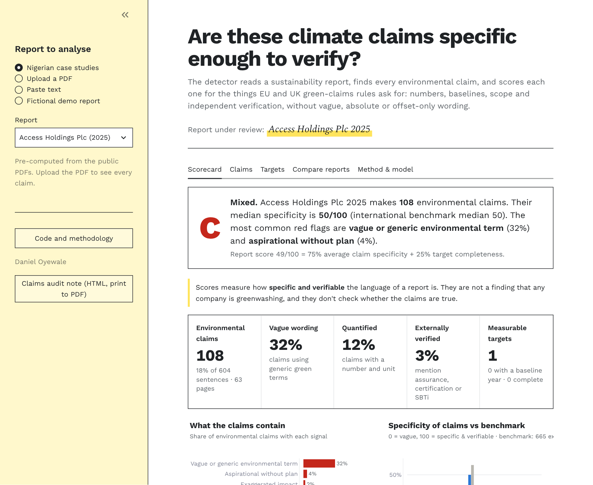
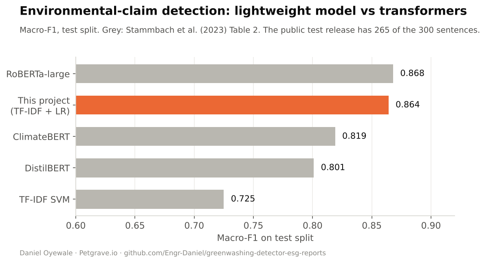
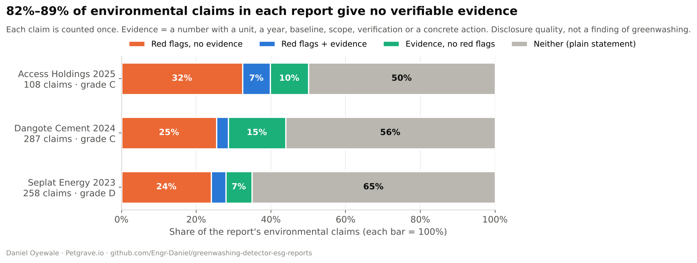
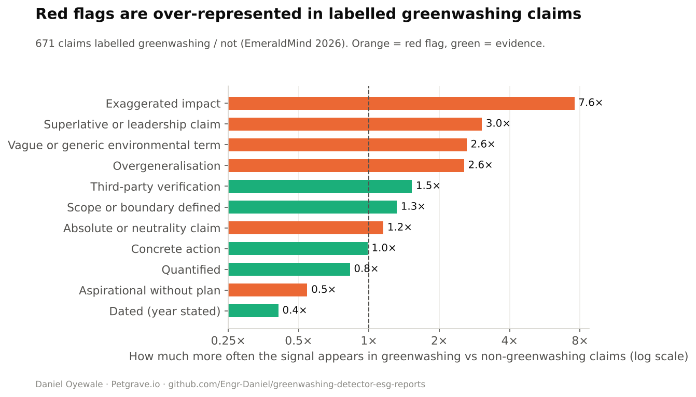
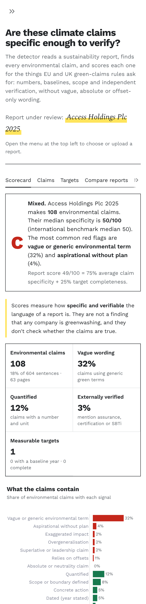

# 🔎 Greenwashing Detector for ESG Reports

[](https://github.com/Engr-Daniel/greenwashing-detector-esg-reports/actions/workflows/tests.yml)
 

📊 Live app: *coming soon* · 📐 [Methodology](docs/methodology.md)

**Are a company's climate claims specific enough to verify?** Upload a sustainability or annual report (PDF). The app
finds every environmental claim with an NLP model, scores each one **0–100 for specificity and verifiability**
against the EU and UK green-claims rules, extracts the climate **targets** and checks them for completeness, and
produces a report scorecard and audit note.

> ⚖️ **Disclosure quality, not a verdict.** The scores measure how specific and verifiable the *language* is. They
> are not a finding that any company is greenwashing and don't check whether claims are true.



## 📊 Key results
| | |
|---|---|
| Claim detector (TF-IDF + logistic regression) | **macro-F1 0.864** on the expert-labelled test set: above ClimateBERT (0.819), on par with RoBERTa-large (0.868), and runs in milliseconds on a CPU |
| Greenwashing-language model | **ROC-AUC 0.78** (5-fold CV, 671 labelled claims) |
| Strongest red flags | Exaggerated impact appears **7.6×** more often in greenwashing claims; superlatives 3.0×; vague terms 2.6× |
| Nigerian case studies | Access Holdings 2025 **C**, Dangote Cement 2024 **C**, Seplat Energy 2023 **D**. **82–89% of environmental claims give no verifiable evidence**. External verification is mentioned in ≤3% |



### Nigerian sustainability reports


- **Most claims can't be checked.** Every claim is put in exactly one group. 82–89% either carry red flags with
  no evidence (24–32%) or are plain statements with neither (50–65%). Only 7–15% are specific with no red flags,
  and external assurance is mentioned in ≤3%. Under IFRS S2, which Nigeria is adopting through the FRC roadmap, emissions and
  targets must be quantified.
- **Targets lack baselines.** Of 11 measurable targets found, 1 states a baseline year (Dangote's Scope 1 and 2
  intensity target: 691 → 563 kgCO₂/t, 2021 → 2030).
- **The best disclosures look like this:** *"Net Scope 1 CO₂ intensity reduced by 1.2% from 577 kgCO₂/tonne
  cementitious material in 2023 to 570…"* (Dangote, p. 43) or *"Scope 3 emissions from business travel reduced by
  approximately 49%, from 3,293 tCO₂e in 2024 to 1,668 tCO₂e in 2025…"* (Access, p. 46).



## 🧭 How it works
1. **Read the PDF** (`pdftext.py`): pypdf text extraction, cleaning and sentence splitting, with tables and
   infographic fragments filtered out.
2. **Detect claims** (`models.py`): word and character TF-IDF with logistic regression, trained on 2,647
   expert-labelled sentences (Stammbach et al., ACL 2023).
3. **Score specificity** (`scoring.py`): 13 transparent signals from [`red_flags.csv`](data/reference/red_flags.csv),
   each tied to a rule:
   - red flags: vague, absolute, superlative, overgeneralised, exaggerated, offset-based or aspirational wording
   - evidence: numbers, year, baseline, scope, third-party verification, concrete action
4. **Language risk** (`models.py`): a model trained on 671 claims labelled greenwashing or not (EmeraldMind, 2026).
5. **Targets** (`targets.py`): target year, baseline, % change and scope, plus a completeness check (GHG Protocol,
   IFRS S2).
6. **Scorecard and audit note** (`analyse.py`, app): grade A–E, red-flag profile, benchmark comparison, the
   weakest and strongest claims, and questions to ask the company.

Full details and limitations: [docs/methodology.md](docs/methodology.md).

## 🖥️ The app
- **Scorecard:** grade, KPIs, red-flag profile, specificity vs an international benchmark, weakest and strongest
  claims, and questions for investors or regulators
- **Claims:** every claim, filterable by red flag. Click one to see exactly which signals moved its score and why
  (with regulatory references), plus an optional second opinion from an LLM using your own Anthropic key
- **Targets:** measurable targets with a ✓/✗ completeness check
- **Compare reports:** the three Nigerian case studies alongside your upload
- Sources: Nigerian case studies · upload any PDF · paste text · a fictional demo report



## 🗂️ Structure
```
├── app/streamlit_app.py           # Streamlit app (desktop + mobile)
├── data/
│   ├── raw/                       # environmental-claims + EmeraldMind datasets (reports/ is git-ignored)
│   ├── reference/red_flags.csv    # signals, weights, regex, rationale, regulatory source
│   └── processed/                 # model_metrics.json, case_studies.json
├── models/                        # claim_detector.joblib, greenwashing_risk.joblib
├── sample_reports/                # fictional demo report
├── src/greenwash/                 # pdftext, scoring, targets, models, analyse, case_studies, figures
├── tests/                         # pytest (CI)
├── docs/methodology.md
└── AGENTS.md · MEMORY.md · TASK.md
```

## 🚀 Getting started
```bash
git clone https://github.com/Engr-Daniel/greenwashing-detector-esg-reports.git
cd greenwashing-detector-esg-reports
pip install -r requirements-dev.txt
streamlit run app/streamlit_app.py
python src/greenwash/models.py              # retrain + evaluate (≈10 s)
python src/greenwash/analyse.py report.pdf  # command-line scorecard
pytest -q
```

## 📚 Sources
- Stammbach, Webersinke, Bingler, Kraus & Leippold (2023), [*Environmental Claim Detection*](https://aclanthology.org/2023.acl-short.91/), ACL. Dataset: [GitHub](https://github.com/dominiksinsaarland/environmental_claims)
- Kaoukis et al. (2026), *EmeraldMind: a knowledge-graph-augmented framework for greenwashing detection*, WWW '26. Dataset: [GitHub](https://github.com/ai4greenwashing/EmeraldMind) (Apache 2.0)
- EU Directive 2024/825 (Empowering Consumers for the Green Transition) · UK CMA [Green Claims Code](https://www.gov.uk/government/publications/green-claims-code-making-environmental-claims) · GHG Protocol Corporate Standard · ISSB IFRS S2
- Company reports: Access Holdings Sustainability Report 2025 · Dangote Cement 2024 Sustainability Report · Seplat Energy Sustainability Report 2023

## 👤 Author
**Daniel Oyewale**, Data Analyst · Data Strategist · Sustainability Researcher at [Petgrave.io](https://petgrave.io).
Other projects: [Carbon Footprint & ESG Dashboard](https://github.com/Engr-Daniel/carbon-footprint-esg-dashboard) ·
[Solar Mini-Grid Site Suitability](https://github.com/Engr-Daniel/solar-minigrid-site-suitability-nigeria)
